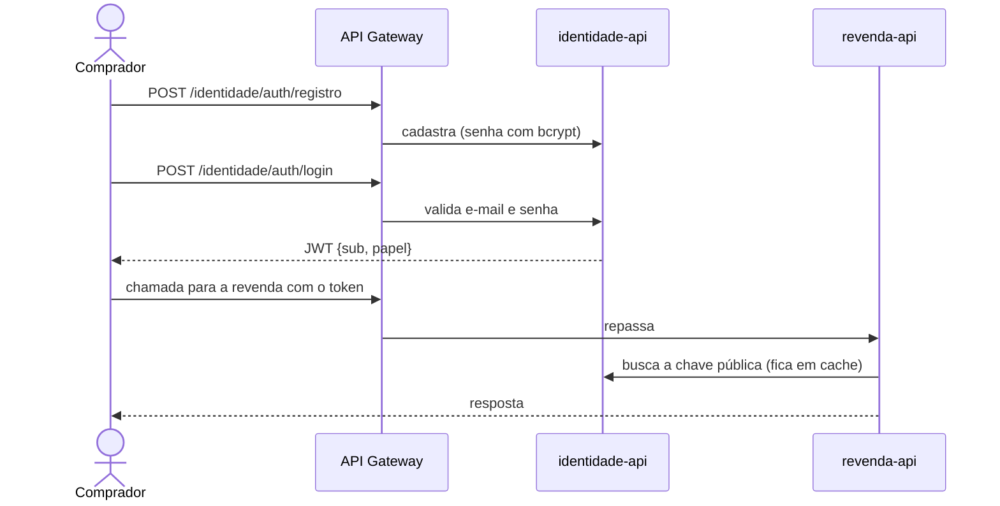

# Revenda de Veículos - Serviço de Identidade

Trabalho substitutivo do Tech Challenge da Fase 3 (FIAP PósTech - Software Architecture).
Giovana de Fatima Moraes - RM 366418

A solução está dividida em dois repositórios. Este é o serviço de identidade, responsável pelo cadastro e login dos compradores. A API da revenda (veículos, vendas, API Gateway e monitoramento) está em [revenda-veiculos](https://github.com/Gio-vana/revenda-veiculos).

Ambiente publicado (até 15/12/2026):

- Swagger: http://34.202.251.69/identidade/docs
- Chave pública (JWKS): http://34.202.251.69/identidade/.well-known/jwks.json

## O que é

O enunciado pede que o registro e a autorização dos compradores fiquem totalmente separados do resto da solução. Por isso este serviço tem repositório, banco de dados, pipeline e deploy próprios.

Endpoints (pelo API Gateway):

| Endpoint | Para que serve |
|---|---|
| `POST /identidade/auth/registro` | Cadastro do comprador (nome, e-mail, CPF, telefone e senha) |
| `POST /identidade/auth/login` | Login. Devolve um JWT válido por 60 minutos |
| `GET /identidade/auth/me` | Dados do usuário logado |
| `GET /identidade/.well-known/jwks.json` | Chave pública para outros serviços validarem o token |

Todo cadastro recebe o papel `cliente`. Na primeira vez que o serviço sobe, ele cria um usuário `gestor` com o e-mail e a senha definidos em `GESTOR_EMAIL` e `GESTOR_PASSWORD`.

Os dados pessoais (nome, e-mail, CPF, telefone e hash da senha) ficam só aqui. O token não carrega nenhum desses dados, só o id do usuário (`sub`) e o papel. A API da revenda valida o token com a chave pública e nunca acessa este banco.

## Como foi implementado

- Python 3.12 com FastAPI e Pydantic (o e-mail é validado e o CPF passa pela verificação dos dígitos)
- Senhas guardadas com bcrypt
- Tokens assinados com RS256 (PyJWT). A chave pública é publicada em formato JWKS
- PostgreSQL 16 exclusivo deste serviço
- Métricas para o Prometheus em `/metrics` (o gateway não expõe esse endpoint)
- CI/CD com GitHub Actions

```
app/
  main.py       criação da aplicação e do usuário gestor
  routes.py     endpoints
  security.py   hash de senha, chaves RSA, emissão e validação do token
  models.py     tabela de usuários
  schemas.py    validações
  config.py     configurações via variáveis de ambiente
tests/
```

A chave privada é gerada na primeira execução e fica salva num volume Docker. Ela não vai para o Git. O contrato que a API da revenda usa (issuer, audience, claims) está em [docs/contrato.md](docs/contrato.md).



## Como usar localmente

Precisa do Docker.

```bash
docker network create revenda-net   # rede usada pelos dois repositórios (só uma vez)
cp .env.example .env                # trocar as senhas
docker compose up -d --build
```

Com o repositório `revenda-veiculos` também rodando, o Swagger fica em http://localhost:8080/identidade/docs. Sem ele, dá para acessar direto em http://localhost:8001.

Exemplo:

```bash
curl -X POST http://localhost:8080/identidade/auth/registro -H "Content-Type: application/json" \
  -d '{"nome":"Maria Silva","email":"maria@exemplo.com","cpf":"529.982.247-25","senha":"senha-forte-123"}'

curl -X POST http://localhost:8080/identidade/auth/login -H "Content-Type: application/json" \
  -d '{"email":"maria@exemplo.com","senha":"senha-forte-123"}'
```

## Como testar

```bash
python -m venv .venv
source .venv/bin/activate        # no Windows: .venv\Scripts\activate
pip install -r requirements-dev.txt
pytest
```

Os testes cobrem cadastro, e-mail ou CPF repetido, CPF inválido, login com senha errada, validação do token pela chave publicada, ausência de dados pessoais no token, criação do gestor e `/auth/me`.

O teste ponta a ponta da plataforma (cadastro, login, compra e efetivação) está no repositório da revenda, em `scripts/demo_e2e.py`.

## CI/CD e deploy

A `main` é protegida e só recebe mudanças por Pull Request com o CI passando.

- [`ci.yml`](.github/workflows/ci.yml): lint, testes com cobertura mínima de 80%, build da imagem e validação do docker compose
- [`cd.yml`](.github/workflows/cd.yml): a cada merge na `main`, roda o CI, copia o código para o servidor via SSH, gera o `.env` a partir dos secrets, sobe os containers e confere se o JWKS está respondendo

Secrets (environment `producao`): `SSH_HOST`, `SSH_USER`, `SSH_PRIVATE_KEY`, `IDENTIDADE_DB_PASSWORD` e `GESTOR_PASSWORD`.

O servidor é preparado uma vez com [`infra/servidor/preparar-servidor.sh`](infra/servidor/preparar-servidor.sh). A decisão de fazer um serviço próprio está registrada em [docs/adrs](docs/adrs).
