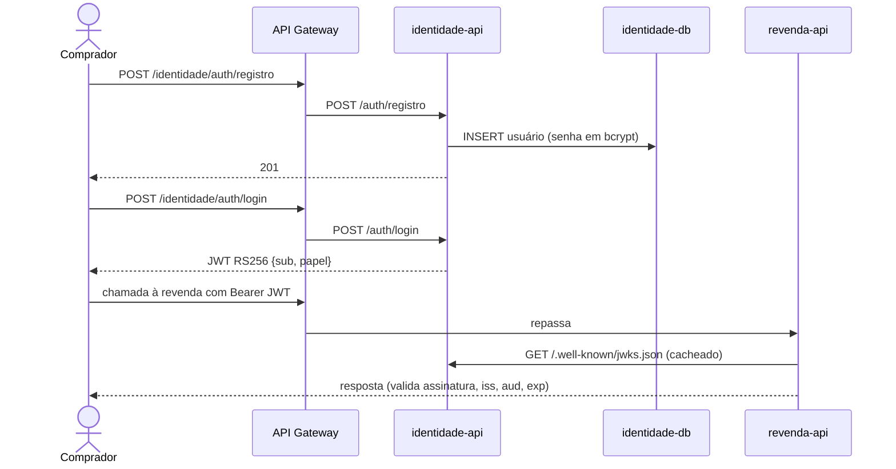

# Revenda de Veículos: Serviço de Identidade

Trabalho Substitutivo do Tech Challenge, FIAP PósTech Software Architecture (SOAT), Fase 3.
Autor(a): Giovana de Fatima Moraes, RM _<seu RM>_

> **A entrega tem dois repositórios.** Este é o **serviço de identidade**: cadastro e autenticação de compradores, **totalmente apartado** do resto da solução, como exige o enunciado. A API da revenda (veículos, vendas, API Gateway e monitoramento) está em [revenda-veiculos](https://github.com/Gio-vana/revenda-veiculos).

## Ambiente publicado

| O quê | Endereço |
|---|---|
| Swagger da identidade (pelo API Gateway) | http://34.202.251.69/identidade/docs |
| Chave pública (JWKS) | http://34.202.251.69/identidade/.well-known/jwks.json |

Disponível até 15/12/2026.

## 1. O que é

Serviço responsável pelos **dados pessoais** dos compradores e pela emissão das credenciais de acesso:

| Endpoint (pelo API Gateway) | Para quê |
|---|---|
| `POST /identidade/auth/registro` | Cadastro do comprador (nome, e-mail, CPF, telefone, senha) com papel `cliente` |
| `POST /identidade/auth/login` | Autenticação; devolve um JWT (RS256) válido por 60 minutos |
| `GET /identidade/auth/me` | Dados do próprio usuário autenticado |
| `GET /identidade/.well-known/jwks.json` | Chave pública para outros serviços validarem os tokens |
| `GET /identidade/docs` | Swagger |

Um usuário **gestor** (papel `gestor`) é criado automaticamente na primeira subida, a partir de `GESTOR_EMAIL` e `GESTOR_PASSWORD`.

### Por que separado

- **Outro repositório, outro pipeline, outro banco** (PostgreSQL próprio, numa rede Docker que a revenda não alcança).
- Nome, e-mail, CPF, telefone e hash da senha existem **só aqui**. O token enviado à revenda contém apenas `sub` (id opaco), `papel` e os campos técnicos (`iss`, `aud`, `iat`, `exp`, `jti`); nenhum dado pessoal.
- A revenda confia no token verificando a assinatura com a chave pública (JWKS), sem nunca consultar o banco de identidade.

## 2. Como foi implementado

| Camada | Tecnologia |
|---|---|
| API | Python 3.12, FastAPI, Pydantic v2 (validação de e-mail e CPF com dígitos verificadores) |
| Senhas | bcrypt (hash com sal; a senha nunca é armazenada nem devolvida) |
| Tokens | PyJWT + cryptography: RS256, `kid` derivado da chave pública, JWKS publicado |
| Banco | PostgreSQL 16, exclusivo deste serviço |
| Métricas | Prometheus em `/metrics` (coletado pela rede interna; bloqueado no gateway) |
| CI/CD | GitHub Actions (CI em todo PR, CD a cada merge na `main`) |

```
app/
  main.py       criação da aplicação, criação do gestor
  routes.py     endpoints
  security.py   hash de senha, par de chaves RSA, emissão e validação do JWT, JWKS
  models.py     tabela de usuários
  schemas.py    validação (e-mail, CPF, senha)
  config.py     configuração por variáveis de ambiente
tests/          testes automatizados
```

A chave privada RSA é gerada na primeira subida e guardada num volume Docker (`identidade-chaves`), com permissão 600; nunca vai para o Git. O contrato completo consumido pela revenda está em [docs/contrato.md](docs/contrato.md).



## 3. Como usar localmente

**Pré-requisito**: Docker Desktop.

```bash
docker network create revenda-net   # rede compartilhada com o repositório da revenda (uma vez)
cp .env.example .env                 # troque as senhas
docker compose up -d --build
```

O serviço fica acessível pelo API Gateway (suba também o repositório `revenda-veiculos`) em `http://localhost:8080/identidade/docs`, e diretamente em `http://localhost:8001` para depuração.

Exemplo:

```bash
curl -X POST http://localhost:8080/identidade/auth/registro -H "Content-Type: application/json" \
  -d '{"nome":"Maria Silva","email":"maria@exemplo.com","cpf":"529.982.247-25","senha":"senha-forte-123"}'

curl -X POST http://localhost:8080/identidade/auth/login -H "Content-Type: application/json" \
  -d '{"email":"maria@exemplo.com","senha":"senha-forte-123"}'
```

## 4. Como testar

```bash
python -m venv .venv && source .venv/bin/activate   # Windows: .venv\Scripts\activate
pip install -r requirements-dev.txt
pytest
```

15 testes cobrem: cadastro, duplicidade de e-mail/CPF (409), CPF inválido (422), login, senha errada (401), token validado pelo JWKS publicado, ausência de dados pessoais no token, criação do gestor, `/auth/me` e persistência da chave entre reinícios. Cobertura mínima exigida: 80%.

O teste início-a-fim da plataforma (cadastro, login, compra e efetivação) está no repositório da revenda: `scripts/demo_e2e.py`.

## 5. CI/CD e deploy

| Workflow | Quando | O que faz |
|---|---|---|
| [`ci.yml`](.github/workflows/ci.yml) | Todo PR (e chamado pelo CD) | ruff, pytest com cobertura, build da imagem e validação do compose |
| [`cd.yml`](.github/workflows/cd.yml) | Merge na `main` ou manual | Roda o CI; copia o código para o servidor por SSH; grava o `.env` a partir dos *secrets*; `docker compose up -d --build`; teste de fumaça no JWKS |

A `main` é protegida: só recebe mudanças por Pull Request com o CI verde.

**Secrets** (environment `producao`): `SSH_HOST`, `SSH_USER`, `SSH_PRIVATE_KEY`, `IDENTIDADE_DB_PASSWORD`, `GESTOR_PASSWORD`.

O servidor é preparado uma vez com [`infra/servidor/preparar-servidor.sh`](infra/servidor/preparar-servidor.sh). Decisões de arquitetura em [docs/adrs](docs/adrs).
